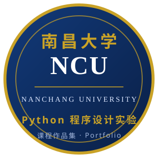

<div align="center">



# Python 程序设计实验 · 课程作品集

**南昌大学** · 大学物理实验中心 / 计算机基础教学部


</div>

---

## 个人信息

| 项目 | 内容 |
| :--- | :--- |
| **学校** | 南昌大学 |
| **学号** | `5715126035` |
| **姓名** | 臧梓贺 |
| **专业** | 物理学 |
| **课程** | Python 程序设计实验 |
| **学期** | 2025–2026 学年 |

> 本仓库为《Python 程序设计实验》课程的个人作品集主仓库，按周组织每一次实验的代码、报告与思考记录。

---

## 目录结构（全学期 16 周）

```text
Python-Programming-Lab/
├── README.md                  # 本文件：仓库总览
├── .gitignore                 # Git 忽略规则（Python 专用）
├── assets/                    # 图片、徽标等静态资源
│   └── ncu-logo.svg
│
├── 第01周_开发环境搭建与第一个程序/
├── 第02周_变量与数据类型/
├── 第03周_运算符与表达式/
├── 第04周_流程控制之分支结构/
├── 第05周_流程控制之循环结构/
├── 第06周_字符串与列表/
├── 第07周_元组字典与集合/
├── 第08周_函数与模块/
├── 第09周_文件读写与异常处理/
├── 第10周_面向对象编程基础/
├── 第11周_面向对象进阶与继承/
├── 第12周_常用标准库/
├── 第13周_NumPy与Pandas入门/
├── 第14周_Matplotlib数据可视化/
├── 第15周_综合项目开发/
└── 第16周_课程设计与答辩/
```

---

## 每周实验进度

| 周次 | 实验主题 | 核心知识点 | 状态 |
| :--: | :--- | :--- | :--: |
| 01 | 开发环境搭建与第一个程序 | 解释器、IDE、`print`、变量 | ⬜ |
| 02 | 变量与数据类型 | `int` / `float` / `str` / `bool` | ⬜ |
| 03 | 运算符与表达式 | 算术、比较、逻辑运算 | ⬜ |
| 04 | 流程控制之分支结构 | `if` / `elif` / `else` | ⬜ |
| 05 | 流程控制之循环结构 | `for` / `while` / `break` / `continue` | ⬜ |
| 06 | 字符串与列表 | 索引、切片、常用方法 | ⬜ |
| 07 | 元组、字典与集合 | 映射与集合运算 | ⬜ |
| 08 | 函数与模块 | 参数、返回值、作用域、`import` | ⬜ |
| 09 | 文件读写与异常处理 | `open`、`with`、`try` / `except` | ⬜ |
| 10 | 面向对象编程基础 | 类、对象、属性、方法 | ⬜ |
| 11 | 面向对象进阶与继承 | 封装、继承、多态 | ⬜ |
| 12 | 常用标准库 | `os`、`datetime`、`random`、`re` | ⬜ |
| 13 | NumPy 与 Pandas 入门 | 数组运算、数据表处理 | ⬜ |
| 14 | Matplotlib 数据可视化 | 折线图、散点图、直方图 | ⬜ |
| 15 | 综合项目开发 | 需求分析、模块化实现 | ⬜ |
| 16 | 课程设计与答辩 | 项目整合、报告撰写、演示 | ⬜ |

> 状态图例：⬜ 未开始 · 🟨 进行中 · ✅ 已完成

---

## 每周文件夹约定

每个实验周的文件夹内建议包含：

```text
第XX周_实验主题/
├── README.md          # 本周实验报告（目的、步骤、结果、思考）
├── main.py            # 主程序 / 入口
├── exercises/         # 课堂练习代码
└── data/              # 本周用到的数据文件（如需要）
```

---

## 如何运行

1. 安装 Python 3.10 或更高版本（[python.org](https://www.python.org/downloads/)）。
2. 克隆本仓库：

   ```bash
   git clone <你的仓库地址>
   cd Python-Programming-Lab
   ```

3. 进入对应周次文件夹，运行：

   ```bash
   python main.py
   ```

---

## 提交规范（Commit 约定）

| 前缀 | 含义 |
| :--- | :--- |
| `feat:` | 新增实验代码或功能 |
| `fix:` | 修复代码问题 |
| `docs:` | 更新文档 / 实验报告 |
| `refactor:` | 重构代码（不改变功能） |
| `chore:` | 杂项（配置、目录调整等） |

示例：`feat(第05周): 完成循环结构实验代码`

---

<div align="center">

**南昌大学 · 物理学 · 臧梓贺 · 学号 5715126035**

<sub>本仓库仅用于课程学习与作品存档</sub>

</div>
